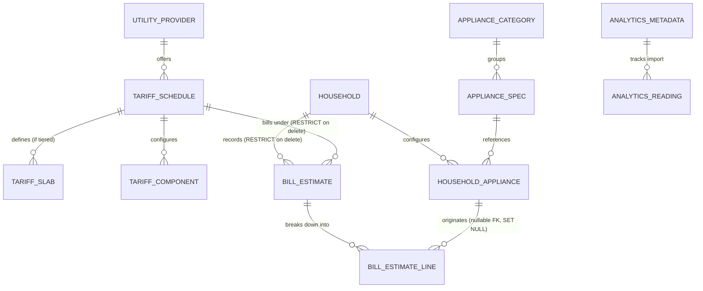

# Smart Energy Usage Monitor — Implementation Architecture
**Status:** Approved for Implementation | **Version:** 1.2 | **Date:** 2026-11-24

---

## A. Modular Folder Structure

```
Smart_Energy_Usage_moniter/
│
├── app.py                          # Streamlit entry point — multi-page router & shell
│
├── config/
│   └── settings.py                 # App-wide constants (DB path, page config, units, defaults)
│
├── data/
│   ├── raw/
│   │   └── electricity_bill_dataset.csv   # Kaggle dataset — read-only, exploratory only
│   ├── seeds/
│   │   ├── appliances.json         # Curated multi-method appliance catalogue seeds
│   │   ├── tariffs_bescom.json     # BESCOM LT-1 tariff schedule & component seeds
│   │   └── README.md               # Source citations for every seed value & revision
│   └── energy_monitor.db           # SQLite database (auto-initialized on first run)
│
├── db/
│   ├── __init__.py
│   ├── connection.py               # Connection factory with FK & WAL pragma, context managers
│   ├── schema.py                   # CREATE TABLE, indexes, and constraint statements
│   └── seed_loader.py              # Idempotent seed populator for empty tables
│
├── modules/
│   ├── estimator/
│   │   ├── __init__.py
│   │   ├── household.py            # Household & appliance CRUD, load & archival management
│   │   ├── consumption_engine.py   # Multi-method appliance consumption calculations
│   │   ├── tariff_engine.py        # Bill calculation logic (single-rate/slabs, duty, FPPCA, informational Gruha Jyothi)
│   │   └── bill_history.py         # Snapshot persistence & historical reproducibility logic
│   │
│   └── analytics/
│       ├── __init__.py
│       ├── loader.py               # Idempotent CSV loader into analytics_reading table
│       ├── queries.py              # Aggregations, distributions & exploratory queries
│       └── charts.py               # Matplotlib / Seaborn visualization builders
│
├── pages/
│   ├── 1_Analytics.py              # Historical Energy Analytics Dashboard (Phase 1)
│   └── 2_Estimator.py              # Household Energy Estimator & Bill Simulator (Phase 5)
│
├── tests/
│   ├── test_schema.py              # Schema integrity, foreign keys & constraint checks
│   ├── test_consumption_engine.py  # Unit tests for multi-method appliance calculations & standby rules
│   ├── test_tariff_engine.py       # Unit tests for BESCOM LT-1, fixed charges, unverified flags, Gruha Jyothi indicator
│   ├── test_history_snapshots.py   # Reproducibility verification & household deletion protection tests
│   └── test_seed_loader.py         # Seed data verification
│
├── requirements.txt
├── README.md
└── architecture.md                 # System architecture specification (this file)
```

> [!NOTE] 
> `data/raw/` is **strictly read-only at runtime**. The original Kaggle CSV (`electricity_bill_dataset.csv`) and the tariff reference PDF (`Tariff_and_Duty_of_Electricity_Supply_in_India-March_2026.pdf`) are never modified, moved, or deleted by the application.

---

## B. Normalised SQLite Schema

### Design Principles
1. **Multi-Method Consumption Modeling**: Appliances calculate energy using the appropriate physical metric (`rated_wattage`, `annual_kwh`, `kwh_per_cycle`, or `user_supplied`). `rated_watt` is nullable.
2. **Explicit Standby Load Modeling**: Standby consumption is evaluated **only** when an appliance physically supports standby mode (`supports_standby = 1`) and the user explicitly enables it. Unused hours are never automatically assumed to be standby hours. Mechanical switch appliances (fans, irons, heaters) never receive phantom standby loads. Standby wattage defaults to 0 W when unverified.
3. **First-Class Componentized Tariffs**: Energy rates (single-rate or slab-tiered), fixed charges, electricity duty, FPPCA, P&G surcharges, and true-up adjustments are distinct entities with explicit units, calculation methods, effective date ranges, and verification states.
4. **Gruha Jyothi Entitlement Modeling (Informational in MVP)**: Stored as entitlement policy metadata (average usage + 10% buffer, capped at 200 units ceiling) with informational status. Actual monetary subsidy calculation is **deferred in the MVP** pending official verification of GOK/KERC billing rules to prevent invented financial deductions.
5. **Immutable Historical Snapshots & Deletion Protection**: Every saved estimate preserves an immutable snapshot of all appliance specifications, usage assumptions, applied tariff rates, and component statuses. Modifying or deleting an appliance or spec never alters past bills (`ON DELETE SET NULL` on line items). Deleting a household cannot cascade-delete historical estimates (`ON DELETE RESTRICT` on `bill_estimate.household_id`); household profiles support safe archival (`is_archived = 1`).
6. **Strict Data Isolation**: The Kaggle analytics dataset lives in an isolated table (`analytics_reading`) with zero foreign keys to user households or estimates.
7. **Financial Precision**: All monetary values are represented as **integers in paise** (1 ₹ = 100 paise) to eliminate floating-point rounding errors.
8. **No Null-Ambiguity in Unique Constraints**: The SQLite unique constraint on `tariff_schedule` uses a concrete default (`scheme_name TEXT NOT NULL DEFAULT 'standard'`), preventing duplicate issues with nullable columns in SQLite.
9. **Foreign Key Integrity**: `PRAGMA foreign_keys = ON;` is enforced at every connection.

---

### Entity-Relationship Overview



---

### Complete SQL Table Definitions

```sql
-- ============================================================
-- PRAGMA ENFORCEMENT
-- ============================================================
PRAGMA foreign_keys = ON;
PRAGMA journal_mode = WAL;

-- ============================================================
-- 1. UTILITY PROVIDER
-- ============================================================
CREATE TABLE IF NOT EXISTS utility_provider (
    provider_id     INTEGER PRIMARY KEY AUTOINCREMENT,
    code            TEXT    NOT NULL UNIQUE,          -- 'BESCOM', 'MESCOM'
    name            TEXT    NOT NULL,                 -- 'Bangalore Electricity Supply Company Limited'
    state           TEXT    NOT NULL DEFAULT 'Karnataka',
    city_coverage   TEXT,                             -- JSON list of cities/districts covered
    is_active       INTEGER NOT NULL DEFAULT 1,
    created_at      TEXT    NOT NULL DEFAULT (datetime('now'))
);

-- ============================================================
-- 2. TARIFF SCHEDULE (Base Tariff Header)
-- ============================================================
CREATE TABLE IF NOT EXISTS tariff_schedule (
    schedule_id             INTEGER PRIMARY KEY AUTOINCREMENT,
    provider_id             INTEGER NOT NULL REFERENCES utility_provider(provider_id) ON DELETE RESTRICT,
    category_code           TEXT    NOT NULL,         -- 'LT-1'
    category_name           TEXT    NOT NULL,         -- 'Domestic (LT-1)'
    tariff_version          TEXT    NOT NULL,         -- 'BESCOM-LT1-FY2026-27-V1'
    energy_tariff_type      TEXT    NOT NULL DEFAULT 'single_rate', -- 'single_rate' | 'slab_tiered'
    base_energy_rate_paise  INTEGER,                  -- e.g. 580 for ₹5.80/kWh when single_rate; NULL if slab_tiered
    effective_from          TEXT    NOT NULL,         -- ISO date '2026-04-01'
    effective_to            TEXT,                     -- NULL = currently active revision
    scheme_name             TEXT    NOT NULL DEFAULT 'standard', -- 'standard' or specific scheme name (never NULL)
    source_ref              TEXT    NOT NULL,         -- 'KERC Tariff Order FY 2026-27 / CEA March 2026'
    is_verified             INTEGER NOT NULL DEFAULT 0, -- 1 = confirmed against primary tariff order; 0 = indicative
    notes                   TEXT,
    created_at              TEXT    NOT NULL DEFAULT (datetime('now')),
    UNIQUE (provider_id, category_code, effective_from, scheme_name)
);

-- ============================================================
-- 3. TARIFF SLABS (Optional: for tiered energy tariffs)
-- ============================================================
CREATE TABLE IF NOT EXISTS tariff_slab (
    slab_id         INTEGER PRIMARY KEY AUTOINCREMENT,
    schedule_id     INTEGER NOT NULL REFERENCES tariff_schedule(schedule_id) ON DELETE CASCADE,
    slab_order      INTEGER NOT NULL,                 -- 1, 2, 3...
    unit_from       INTEGER NOT NULL,                 -- e.g. 0
    unit_to         INTEGER,                          -- e.g. 50, 100; NULL = unlimited (tail slab)
    rate_paise      INTEGER NOT NULL,                 -- energy rate for this slab in paise/kWh
    description     TEXT,                             -- e.g. '0-50 units @ 415 paise/kWh'
    UNIQUE (schedule_id, slab_order)
);

-- ============================================================
-- 4. TARIFF COMPONENTS (Fixed, Duty, FPPCA, P&G, True-up, etc.)
-- ============================================================
CREATE TABLE IF NOT EXISTS tariff_component (
    component_id        INTEGER PRIMARY KEY AUTOINCREMENT,
    schedule_id         INTEGER NOT NULL REFERENCES tariff_schedule(schedule_id) ON DELETE CASCADE,
    component_type      TEXT    NOT NULL,             -- 'fixed_charge', 'electricity_duty', 'fppca', 'pg_surcharge', 'true_up'
    calculation_method  TEXT    NOT NULL,             -- 'per_kw_monthly', 'per_connection_monthly', 'percent_of_energy', 'paise_per_kwh', 'flat_monthly'
    rate_value          TEXT    NOT NULL,             -- stored as string to represent int paise or percentage, e.g. '15000' (₹150), '9.0' (9%), '36' (36p/kWh)
    unit                TEXT    NOT NULL,             -- 'paise/kW/month', 'percent', 'paise/kWh', 'paise/month'
    billing_month       TEXT,                         -- 'YYYY-MM' for monthly variables like FPPCA; NULL if standard across schedule
    effective_from      TEXT    NOT NULL,             -- ISO date '2026-04-01'
    effective_to        TEXT,                         -- NULL = currently active
    source_ref          TEXT    NOT NULL,             -- Citation reference (e.g. 'KERC Order Sec 4.2 / BESCOM Notification')
    is_verified         INTEGER NOT NULL DEFAULT 0,   -- 1 = verified; 0 = unverified / illustrative assumption
    notes               TEXT,
    created_at          TEXT    NOT NULL DEFAULT (datetime('now'))
);

-- ============================================================
-- 5. APPLIANCE CATEGORY
-- ============================================================
CREATE TABLE IF NOT EXISTS appliance_category (
    category_id     INTEGER PRIMARY KEY AUTOINCREMENT,
    name            TEXT    NOT NULL UNIQUE,          -- 'Cooling & Climate', 'Refrigeration', 'Lighting', 'Kitchen', 'Laundry'
    icon            TEXT                              -- UI icon identifier or emoji
);

-- ============================================================
-- 6. APPLIANCE SPECIFICATIONS (Catalogue Source of Truth)
-- ============================================================
CREATE TABLE IF NOT EXISTS appliance_spec (
    spec_id                 INTEGER PRIMARY KEY AUTOINCREMENT,
    category_id             INTEGER NOT NULL REFERENCES appliance_category(category_id) ON DELETE RESTRICT,
    name                    TEXT    NOT NULL,         -- 'Ceiling Fan (BLDC 5-star)', 'Frost Free Refrigerator 260L'
    calculation_method      TEXT    NOT NULL,         -- 'rated_wattage', 'annual_kwh', 'kwh_per_cycle', 'user_supplied'
    rated_watt              INTEGER,                  -- Watts: required for 'rated_wattage'; NULL for others
    annual_kwh              REAL,                     -- kWh/year: used for 'annual_kwh' (e.g. BEE star label)
    kwh_per_cycle           REAL,                     -- kWh/cycle: used for 'kwh_per_cycle' (washing machine, dishwasher)
    supports_standby        INTEGER NOT NULL DEFAULT 0, -- 1 = device supports standby mode (e.g. TV, microwave); 0 = mechanical switch off (fan, iron, heater)
    standby_watt            INTEGER NOT NULL DEFAULT 0, -- Standby power in watts; defaults to 0 W if unverified or inapplicable
    efficiency_star         INTEGER,                  -- BEE star rating 1-5; NULL if unrated
    typical_usage_hrs_day   REAL,                     -- Suggested default daily operating hours
    typical_cycles_per_month REAL,                    -- Suggested default monthly cycles
    source_ref              TEXT    NOT NULL,         -- 'BEE Standards 2024 / Manufacturer Datasheet'
    is_verified             INTEGER NOT NULL DEFAULT 0, -- 1 = confirmed; 0 = illustrative estimate
    notes                   TEXT,
    created_at              TEXT    NOT NULL DEFAULT (datetime('now'))
);

-- ============================================================
-- 7. HOUSEHOLD PROFILE (User Configuration)
-- ============================================================
CREATE TABLE IF NOT EXISTS household (
    household_id                INTEGER PRIMARY KEY AUTOINCREMENT,
    name                        TEXT    NOT NULL,     -- 'Primary Residence'
    city                        TEXT    NOT NULL DEFAULT 'Bengaluru',
    provider_id                 INTEGER NOT NULL REFERENCES utility_provider(provider_id) ON DELETE RESTRICT,
    sanctioned_load_kw          REAL    NOT NULL DEFAULT 1.0, -- Connected load in kW (e.g. 1.0, 3.0, 5.0)
    supply_phase                TEXT    NOT NULL DEFAULT 'single', -- 'single' | 'three'
    is_gruha_jyothi_eligible    INTEGER NOT NULL DEFAULT 0,        -- 1 = enrolled in Gruha Jyothi; 0 = standard LT-1 (Informational in MVP)
    gruha_jyothi_entitlement_source TEXT NOT NULL DEFAULT 'manual', -- 'manual' | 'calculated_from_avg'
    gruha_jyothi_avg_monthly_kwh REAL,                -- Prior 12-month average monthly consumption (kWh)
    gruha_jyothi_entitled_units  REAL,                -- Verified or computed free entitlement units (capped at 200)
    is_archived                 INTEGER NOT NULL DEFAULT 0,        -- 1 = archived (hidden from active selection, protects historical estimates)
    created_at                  TEXT    NOT NULL DEFAULT (datetime('now')),
    updated_at                  TEXT    NOT NULL DEFAULT (datetime('now'))
);

-- ============================================================
-- 8. HOUSEHOLD APPLIANCES (User Appliance List)
-- ============================================================
CREATE TABLE IF NOT EXISTS household_appliance (
    appliance_id            INTEGER PRIMARY KEY AUTOINCREMENT,
    household_id            INTEGER NOT NULL REFERENCES household(household_id) ON DELETE CASCADE,
    spec_id                 INTEGER NOT NULL REFERENCES appliance_spec(spec_id) ON DELETE RESTRICT,
    calculation_method      TEXT    NOT NULL,         -- Inherited from spec, or overridden
    quantity                INTEGER NOT NULL DEFAULT 1,
    daily_hours             REAL,                     -- Used if method == 'rated_wattage'
    days_per_month          INTEGER NOT NULL DEFAULT 30,
    standby_enabled         INTEGER NOT NULL DEFAULT 0, -- Explicitly enabled by user; only valid if spec supports_standby == 1
    daily_standby_hours     REAL DEFAULT 0,           -- Explicit standby hours per day; never automatically assumed as (24 - daily_hours)
    cycles_per_month        REAL,                     -- Used if method == 'kwh_per_cycle'
    custom_watt             INTEGER,                  -- User override for rated_watt
    custom_annual_kwh       REAL,                     -- User override for annual_kwh
    custom_kwh_per_cycle    REAL,                     -- User override for kwh_per_cycle
    custom_monthly_kwh      REAL,                     -- Direct entry if method == 'user_supplied'
    label                   TEXT,                     -- User custom tag, e.g. 'Master Bedroom AC'
    created_at              TEXT    NOT NULL DEFAULT (datetime('now'))
);

-- ============================================================
-- 9. BILL ESTIMATE (Immutable Calculation Snapshot Header)
-- ============================================================
CREATE TABLE IF NOT EXISTS bill_estimate (
    estimate_id                     INTEGER PRIMARY KEY AUTOINCREMENT,
    household_id                    INTEGER NOT NULL REFERENCES household(household_id) ON DELETE RESTRICT, -- RESTRICT protects past estimates from household deletion
    schedule_id                     INTEGER NOT NULL REFERENCES tariff_schedule(schedule_id) ON DELETE RESTRICT,
    billing_month                   TEXT    NOT NULL, -- 'YYYY-MM'
    total_kwh                       REAL    NOT NULL, -- Total estimated consumption (kWh)
    sanctioned_load_kw_snapshot     REAL    NOT NULL, -- Snapshot of sanctioned load at calculation
    
    -- Energy Charge Calculation Snapshot
    energy_tariff_type_snapshot     TEXT    NOT NULL, -- 'single_rate' | 'slab_tiered'
    energy_rate_paise_snapshot      INTEGER,          -- Base rate in paise/kWh if single_rate (580)
    gross_energy_charge_paise       INTEGER NOT NULL, -- Total energy charge before subsidies
    
    -- Fixed Charge Snapshot
    fixed_charge_rate_paise_snapshot INTEGER NOT NULL, -- e.g. 15000 paise/kW/month (₹150)
    fixed_charge_paise              INTEGER NOT NULL, -- Computed fixed charge
    
    -- Supplementary Components & Component Audit Statuses
    duty_paise                      INTEGER NOT NULL,
    duty_status                     TEXT    NOT NULL DEFAULT 'verified', -- 'verified' | 'unverified' | 'missing'
    fppca_paise                     INTEGER NOT NULL DEFAULT 0,
    fppca_rate_paise_snapshot       INTEGER,
    fppca_status                    TEXT    NOT NULL DEFAULT 'missing',  -- 'verified' | 'unverified' | 'missing'
    pg_surcharge_paise              INTEGER NOT NULL DEFAULT 0,
    pg_surcharge_status             TEXT    NOT NULL DEFAULT 'missing',  -- 'verified' | 'unverified' | 'missing'
    true_up_paise                   INTEGER NOT NULL DEFAULT 0,
    true_up_status                  TEXT    NOT NULL DEFAULT 'missing',  -- 'verified' | 'unverified' | 'missing'
    
    -- Gruha Jyothi Indicator (Informational in MVP — Monetary Calculation Deferred)
    gruha_jyothi_eligible           INTEGER NOT NULL DEFAULT 0, -- Snapshot of enrollment eligibility
    gruha_jyothi_entitled_units_snapshot REAL,        -- Entitled free units snapshot (informational)
    gruha_jyothi_status             TEXT    NOT NULL DEFAULT 'deferred_in_mvp', -- 'deferred_in_mvp' | 'not_eligible'
    subsidy_paise                   INTEGER NOT NULL DEFAULT 0, -- 0 in MVP (monetary subsidy deferred pending official verification)
    
    -- Net Payable Amount (Standard LT-1 in MVP)
    net_payable_paise               INTEGER NOT NULL, -- Final estimated payable amount in paise
    
    -- Audit & Reproducibility Metadata
    tariff_version_snapshot         TEXT    NOT NULL, -- Exact tariff schedule version string
    applied_components_json         TEXT    NOT NULL, -- Full JSON audit payload of all component rates & math
    has_unverified_components       INTEGER NOT NULL DEFAULT 0, -- 1 if any component used unverified/missing data
    disclaimer_notice               TEXT    NOT NULL, -- Standard estimation & non-actual-meter disclaimer
    created_at                      TEXT    NOT NULL DEFAULT (datetime('now')),
    notes                           TEXT
);

-- ============================================================
-- 10. BILL ESTIMATE LINE ITEMS (Immutable Appliance Snapshots)
-- ============================================================
CREATE TABLE IF NOT EXISTS bill_estimate_line (
    line_id                     INTEGER PRIMARY KEY AUTOINCREMENT,
    estimate_id                 INTEGER NOT NULL REFERENCES bill_estimate(estimate_id) ON DELETE CASCADE,
    household_appliance_id      INTEGER REFERENCES household_appliance(appliance_id) ON DELETE SET NULL, -- SET NULL preserves snapshot if appliance is removed
    appliance_name_snapshot     TEXT    NOT NULL,     -- Preserves name even if catalog/household deleted
    category_name_snapshot      TEXT    NOT NULL,
    calculation_method_snapshot TEXT    NOT NULL,     -- 'rated_wattage', 'annual_kwh', 'kwh_per_cycle', 'user_supplied'
    power_spec_snapshot         TEXT    NOT NULL,     -- Formatted spec, e.g. '75 W', '260 kWh/yr', '0.85 kWh/cycle'
    quantity_snapshot           INTEGER NOT NULL,
    usage_assumptions_snapshot  TEXT    NOT NULL,     -- Formatted usage, e.g. '8.0 hrs/day, 30 days (standby: 2W for 10h)' or '16 cycles/mo'
    monthly_kwh                 REAL    NOT NULL,     -- Exact calculated consumption for this line
    share_percent               REAL    NOT NULL      -- Percentage of total monthly kWh
);

-- ============================================================
-- 11. ANALYTICS METADATA (Kaggle Dataset Import Ledger)
-- ============================================================
CREATE TABLE IF NOT EXISTS analytics_metadata (
    meta_id         INTEGER PRIMARY KEY AUTOINCREMENT,
    source_file     TEXT    NOT NULL UNIQUE,
    row_count       INTEGER NOT NULL,
    checksum        TEXT    NOT NULL,                 -- SHA-256 hash of raw CSV file
    imported_at     TEXT    NOT NULL DEFAULT (datetime('now'))
);

-- ============================================================
-- 12. ANALYTICS READINGS (Kaggle Dataset — Read-Only Analytical Store)
-- ============================================================
CREATE TABLE IF NOT EXISTS analytics_reading (
    reading_id          INTEGER PRIMARY KEY AUTOINCREMENT,
    meta_id             INTEGER NOT NULL REFERENCES analytics_metadata(meta_id) ON DELETE CASCADE,
    fan                 INTEGER,
    refrigerator        INTEGER,
    air_conditioner     INTEGER,
    television          INTEGER,
    monitor             INTEGER,
    motor_pump          INTEGER,
    month               INTEGER,
    city                TEXT,
    company             TEXT,
    monthly_hours       REAL,
    tariff_rate         REAL,
    electricity_bill    REAL
);

-- ============================================================
-- INDEXES FOR QUERY & JOIN OPTIMIZATION
-- ============================================================
CREATE INDEX IF NOT EXISTS idx_tariff_sched_provider    ON tariff_schedule(provider_id);
CREATE INDEX IF NOT EXISTS idx_tariff_sched_active      ON tariff_schedule(effective_to) WHERE effective_to IS NULL;
CREATE INDEX IF NOT EXISTS idx_tariff_comp_schedule     ON tariff_component(schedule_id);
CREATE INDEX IF NOT EXISTS idx_tariff_slab_schedule     ON tariff_slab(schedule_id);
CREATE INDEX IF NOT EXISTS idx_spec_category            ON appliance_spec(category_id);
CREATE INDEX IF NOT EXISTS idx_spec_method              ON appliance_spec(calculation_method);
CREATE INDEX IF NOT EXISTS idx_hh_appliance_household   ON household_appliance(household_id);
CREATE INDEX IF NOT EXISTS idx_estimate_household       ON bill_estimate(household_id);
CREATE INDEX IF NOT EXISTS idx_estimate_month           ON bill_estimate(billing_month);
CREATE INDEX IF NOT EXISTS idx_estimate_line_estimate   ON bill_estimate_line(estimate_id);
CREATE INDEX IF NOT EXISTS idx_analytics_city           ON analytics_reading(city);
CREATE INDEX IF NOT EXISTS idx_analytics_month          ON analytics_reading(month);
CREATE INDEX IF NOT EXISTS idx_analytics_company        ON analytics_reading(company);
```

---

## C. Data Flow

```mermaid
flowchart TD
    subgraph Sources["External Sources (Read-Only)"]
        CSV["electricity_bill_dataset.csv\n(Kaggle, 45,345 rows)"]
        PDF["CEA Tariff PDF / KERC Orders"]
        BEE["BEE Star Label Standards"]
    end

    subgraph Seeds["Seed Data Layer (data/seeds/)"]
        JS_TARIFF["tariffs_bescom.json\n(Verified LT-1 Rates & Component Seeds)"]
        JS_APPL["appliances.json\n(Verified Multi-Method Specs & Standby Flags)"]
    end

    subgraph Database["SQLite Database (energy_monitor.db)"]
        subgraph Tariffs["Tariff Tables"]
            T_SCHED["tariff_schedule"]
            T_COMP["tariff_component"]
            T_SLAB["tariff_slab"]
        end
        subgraph Household["Household & Appliance Tables"]
            T_SPEC["appliance_spec"]
            T_HH["household (with is_archived)"]
            T_HHA["household_appliance"]
        end
        subgraph History["Immutable History Snapshots"]
            T_EST["bill_estimate (RESTRICT on household delete)"]
            T_LINE["bill_estimate_line"]
        end
        subgraph Analytics["Isolated Analytics Store"]
            T_ANA["analytics_reading\n(Strictly Isolated)"]
        end
    end

    subgraph Engines["Calculation Engines (Pure Functions)"]
        subgraph CE["1. Consumption Engine (modules/estimator/consumption_engine.py)"]
            CE1["For each appliance:\nEvaluate calculation_method"]
            CE2["rated_wattage: (watts * qty * hrs * days) / 1000\n+ standby strictly if supported & enabled"]
            CE3["annual_kwh: (annual_kwh / 12) * qty"]
            CE4["kwh_per_cycle: (kwh_per_cycle * cycles) * qty"]
            CE5["user_supplied: direct monthly kWh entry"]
            CE6["Sum total_kwh & compute line shares"]
        end

        subgraph TE["2. Tariff Engine (modules/estimator/tariff_engine.py)"]
            TE1["Load active schedule (single_rate or slab_tiered)"]
            TE2["Calculate gross energy charge (e.g. 580 p/kWh)"]
            TE3["Calculate fixed charge (₹150 * sanctioned_load_kw)"]
            TE4["Evaluate duty, FPPCA, P&G, true-up (flag unverified/missing)"]
            TE5["Evaluate Gruha Jyothi status:\n• Display informational eligibility & verified entitlement\n• Actual monetary bill calculation DEFERRED in MVP\n• Standard LT-1 bill calculated with clear non-subsidy notice"]
            TE6["Compute net_payable_paise & generate audit JSON"]
        end
    end

    subgraph UI["Streamlit Frontend"]
        P_ANA["pages/1_Analytics.py\n(Phase 1: EDA Dashboard)"]
        P_EST["pages/2_Estimator.py\n(Phase 5: Estimator & Simulator)"]
    end

    CSV -->|analytics/loader.py (Idempotent)| T_ANA
    T_ANA -->|queries.py & charts.py| P_ANA

    PDF -->|Verified Extraction| JS_TARIFF
    BEE -->|Verified Extraction| JS_APPL
    JS_TARIFF -->|seed_loader.py| Tariffs
    JS_APPL -->|seed_loader.py| T_SPEC

    P_EST -->|CRUD Profiles / Archive| T_HH
    P_EST -->|CRUD Devices| T_HHA

    T_HHA -->|Appliance List & Specs| CE
    CE -->|Total kWh & Line kWh| TE
    Tariffs -->|Rates, Components & Rules| TE
    T_HH -->|Sanctioned Load & Scheme Info| TE

    TE -->|Full Bill Result & Audit Payload| P_EST
    TE -->|Immutable Snapshot Write| T_EST
    CE -->|Appliance Line Snapshots| T_LINE
    T_EST -->|Historical Trend Query| P_EST
```

---

## D. Detailed Logic Specifications

### 1. Multi-Method Appliance Consumption Engine & Standby Rules

The consumption engine operates independently of tariffs. For any given appliance configuration, monthly energy ($E_{\text{monthly}}$ in kWh) is calculated strictly by its declared `calculation_method`:

| Method | Mathematical Formula | Applicability |
| :--- | :--- | :--- |
| `rated_wattage` | $E = E_{\text{active}} + E_{\text{standby}}$ (see detailed formula below) | Fans, TVs, lighting, heating, computing, pumps |
| `annual_kwh` | $E = \frac{\text{Annual\_kWh}_{\text{eff}}}{12} \times Q$ | Refrigerators, freezers (BEE star rating labels) |
| `kwh_per_cycle` | $E = \text{kWh\_per\_cycle}_{\text{eff}} \times Q \times C_{\text{monthly}}$ | Washing machines, dishwashers, dryers |
| `user_supplied` | $E = E_{\text{custom\_monthly}}$ (direct line total) | Smart plug readings, direct sub-meter measurements |

#### Detailed `rated_wattage` and Standby Power Formulation

$$E_{\text{active}} = \frac{P_{\text{eff}} \times Q \times H_{\text{daily}} \times D}{1000}$$

$$E_{\text{standby}} = \begin{cases} 
\frac{P_{\text{standby}} \times Q \times H_{\text{standby}} \times D}{1000} & \text{if } \text{supports\_standby} = 1 \text{ and } \text{standby\_enabled} = 1 \\ 
0 & \text{otherwise} 
\end{cases}$$

$$E_{\text{total}} = E_{\text{active}} + E_{\text{standby}}$$

*Where:*
- $P_{\text{eff}} = \text{custom\_watt} \text{ if set, else } \text{rated\_watt}$
- $P_{\text{standby}} = \text{standby\_watt}$ from catalogue (strictly defaults to $0\,\text{W}$ if unverified or inapplicable)
- $Q = \text{quantity}$, $D = \text{days\_per\_month}$, $H_{\text{daily}} = \text{daily\_hours}$
- $H_{\text{standby}} = \text{daily\_standby\_hours}$ (explicitly specified by the user; **never** automatically computed as $24 - H_{\text{daily}}$)

#### Strict Rules Governing Standby Consumption:
1. **No Phantom Standby on Mechanical-Switch Devices**: Appliances that operate via a mechanical wall on/off switch (such as ceiling fans, clothes irons, water geysers, immersion rods, toasters, and room heaters) have `supports_standby = 0`. Their standby consumption is **strictly $0\,\text{W}$** under all circumstances.
2. **Explicit User Enablement**: Standby power is evaluated only when the device architecture supports remote/digital standby (`supports_standby = 1`, e.g. televisions, set-top boxes, microwave ovens, computing gear) and the user has explicitly checked `standby_enabled = 1`.
3. **Explicit Standby Duration**: Where standby is enabled, the user must define the daily standby duration $H_{\text{standby}}$. Unused hours are **never** automatically assumed to be standby hours.
4. **Default Zero**: When verified standby power data is not available from official BEE or manufacturer specifications, `standby_watt` defaults strictly to $0\,\text{W}$.

---

### 2. Gruha Jyothi Entitlement Modeling (Informational in MVP — Monetary Calculation Deferred)

Gruha Jyothi is the Government of Karnataka's domestic electricity welfare policy. In Version 1.2, **all monetary subsidy calculations, pro-rata deductions, fixed-charge waivers, and zero-bill assumptions are officially DEFERRED in the MVP** pending verification against primary Government of Karnataka Gazette notifications and applicable BESCOM/KERC tariff settlement orders.

#### MVP Functional Scope for Gruha Jyothi:
1. **Policy Metadata & Entitlement Recording**:
   - The user may record their enrollment status (`is_gruha_jyothi_eligible = 1`).
   - The user may record their verified monthly free-unit entitlement (in kWh) as printed on their official BESCOM bill (`gruha_jyothi_entitled_units`), or record their 12-month historical monthly average to compute the indicative entitlement:
     $$\text{Indicative Entitlement} = \min(\lceil\text{avg\_kwh} \times 1.10\rceil, 200.0)$$
2. **Informational Comparison Indicator in UI**:
   - The Estimator UI compares total estimated consumption ($E_{\text{total}}$) against the recorded entitlement:
     - If $E_{\text{total}} \le \text{entitled\_units}$: Displays an informational pill: *"Estimated usage ({total_kwh} kWh) is within your registered entitlement ({entitled_units} kWh)."*
     - If $\text{entitled\_units} < E_{\text{total}} \le 200.0$: Displays: *"Estimated usage ({total_kwh} kWh) exceeds entitlement by {delta} kWh (within 200 kWh ceiling)."*
     - If $E_{\text{total}} > 200.0$: Displays: *"Estimated usage ({total_kwh} kWh) exceeds the statutory 200 kWh Gruha Jyothi ceiling."*
3. **Standard LT-1 Bill Calculation (No Invented Subsidies)**:
   - For all households, the estimated bill is calculated strictly under standard BESCOM LT-1 rates (base energy charge: ₹5.80/kWh, fixed charge: ₹150/kW/month, plus verified duties).
   - `subsidy_paise` is strictly set to `0` in `bill_estimate`.
   - The estimate summary displays a prominent banner:
     > ℹ️ *Gruha Jyothi Notice: Monetary subsidy calculations are currently deferred pending primary-source verification of KERC billing rules. The bill shown reflects standard BESCOM LT-1 charges without subsidy deductions.*

---

### 3. Tariff Components & Verification State Machine

Every tariff component is evaluated with explicit calculation math, units, and status reporting:

| Component | Default FY 2026–27 Rate | Unit | Calculation Method | Handling if Missing/Unverified |
| :--- | :--- | :--- | :--- | :--- |
| **Base Energy Charge** | 580 (₹5.80) | paise/kWh | $\text{total\_kwh} \times \text{rate}$ | **Critical Block**: Calculation cannot proceed without verified base rate. |
| **Fixed Charge** | 15,000 (₹150.00) | paise/kW/month | $\text{sanctioned\_load\_kw} \times \text{rate}$ | **Critical Block**: Cannot proceed without verified fixed charge rate. |
| **Electricity Duty** | 9.0% | percent | $\text{energy\_charge} \times 0.09$ | If unverified, flag `duty_status = 'unverified'` and display warning banner. |
| **FPPCA** | Monthly circular | paise/kWh | $\text{total\_kwh} \times \text{rate}$ | If no circular for month: `fppca_paise = 0`, flag `fppca_status = 'missing'`, warn user. |
| **P&G Surcharge** | ~36–39 | paise/kWh | $\text{total\_kwh} \times \text{rate}$ | If unverified: flag `pg_surcharge_status = 'missing'`, warn user. |
| **True-up Adjustment** | Order specific | paise/kWh | $\text{total\_kwh} \times \text{rate}$ | If absent: flag `true_up_status = 'missing'`. |

**Explicit Status Transparency Rule**:
If any component is missing or unverified, the system sets `has_unverified_components = 1` in `bill_estimate` and displays an amber warning in the UI:
> ⚠️ *Notice: This estimate includes illustrative or unverified values for [FPPCA / Electricity Duty / P&G Surcharge]. Actual BESCOM bills will vary based on current gazetted circulars.*

---

## E. Implementation Roadmap

The roadmap is prioritized to deliver a functioning analytical MVP early (Phase 1), followed by the decoupled consumption engine and verified estimator.


### Detailed Phase Breakdown

#### **Phase 0: Project Foundation & Database**
- Establish project directory structure and dependencies in `requirements.txt`.
- Implement `config/settings.py` for global paths, defaults, and constants.
- Implement `db/connection.py` with foreign key enforcement and WAL mode.
- Implement `db/schema.py` with full SQLite schema and indexes (including `household.is_archived` and `ON DELETE RESTRICT` on `bill_estimate.household_id`).
- Unit tests: verify all table creations, foreign key constraints, cascading rules, and RESTRICT enforcement.

#### **Phase 1: Historical CSV Analytics Dashboard (Early MVP)**
- Implement `modules/analytics/loader.py`: Idempotent bulk import of `electricity_bill_dataset.csv` into `analytics_reading`.
- Implement `modules/analytics/queries.py`: Aggregations by city, month, and tariff distributions.
- Implement `modules/analytics/charts.py`: Visualizations for city averages, monthly trends, and hour-to-bill relationships.
- Implement `pages/1_Analytics.py`: Streamlit dashboard with city/month filters, KPI metric cards, and dataset disclaimers.
- **Milestone 1**: User can launch Streamlit and explore the complete 45,345-row Kaggle dataset visually.

#### **Phase 2: Appliance Catalogue & Seed Infrastructure**
- Prepare `data/seeds/appliances.json` containing verified BEE appliance specifications across all four calculation methods with explicit `supports_standby` flags and verified standby ratings (defaulting to 0 W).
- Prepare `data/seeds/tariffs_bescom.json` containing verified BESCOM LT-1 FY 2026–27 base rates (₹5.80/kWh, ₹150/kW fixed charge) and component metadata.
- Implement `db/seed_loader.py`: Idempotent seed loading into SQLite.
- Unit tests: verify seed parsing, schema insertion, and calculation method validation.

#### **Phase 3: Consumption Engine & Appliance Tests**
- Implement `modules/estimator/consumption_engine.py`:
  - Pure calculation functions supporting `rated_wattage`, `annual_kwh`, `kwh_per_cycle`, and `user_supplied`.
  - Explicit standby load evaluation strictly when `supports_standby = 1` and `standby_enabled = 1`.
  - Zero standby load enforcement for mechanical-switch devices (fans, irons, heaters).
  - Per-appliance share percentage distribution.
- Unit tests (`tests/test_consumption_engine.py`):
  - Verify wattage calculation against known physical constants.
  - Verify that mechanical switch devices never accumulate standby consumption.
  - Verify explicit standby hours calculation.
  - Verify annual kWh division ($E / 12$).
  - Verify cycle multiplication ($E_{\text{cycle}} \times C$).
  - Verify user overrides for power and usage.

#### **Phase 4: Tariff Engine, Informational Gruha Jyothi & Billing Tests**
- Implement `modules/estimator/tariff_engine.py`:
  - Single-rate energy billing (₹5.80/kWh baseline).
  - Fixed charge calculation based on sanctioned load ($kW \times 15000$ paise).
  - Gruha Jyothi informational status evaluator (recording entitlement, ceiling comparison; monetary subsidy set to 0).
  - Supplementary component parser (duty, FPPCA, P&G) with missing/unverified audit flags.
  - Total net payable assembly in integer paise.
- Unit tests (`tests/test_tariff_engine.py`):
  - Test standard non-scheme household calculation.
  - Test Gruha Jyothi informational indicators (within entitlement, exceeding entitlement, exceeding ceiling).
  - Test that monetary subsidy remains 0 and bill reflects standard LT-1 rates with notice.
  - Test unverified component warning states.

#### **Phase 5: Estimator UI & Interactive Simulator**
- Implement `modules/estimator/household.py`: CRUD for household profiles, load, archival flag, and appliance inventory.
- Implement `pages/2_Estimator.py`:
  - Household settings panel: Sanctioned load (kW), phase, Gruha Jyothi eligibility toggle, and average consumption / entitlement inputs.
  - Dynamic appliance selector: Add/edit appliances by category and method, with explicit standby toggles only for supported devices.
  - Calculation summary panel: Itemized bill breakdown (energy, fixed, duty, FPPCA), Gruha Jyothi informational banner, appliance consumption bar/pie chart, and clear estimation disclaimers.

#### **Phase 6: Estimate History, Snapshotting & Polish**
- Implement `modules/estimator/bill_history.py`:
  - Write immutable snapshots to `bill_estimate` and `bill_estimate_line`.
  - Fetch estimate timeline and breakdown views.
- Test historical reproducibility: Verify that altering or deleting an appliance or spec does not alter a saved past estimate.
- Test household deletion protection: Verify that attempts to delete a household with saved estimates trigger `ON DELETE RESTRICT` or archival.
- Add estimate comparison views and exportable summary cards.
- Final documentation and code cleanup.

---

## F. Verification & Test Plan

| Test Area | Target Module / Script | Verification Criteria |
| :--- | :--- | :--- |
| **Multi-Method Consumption** | `tests/test_consumption_engine.py` | 1. `rated_wattage`: 1000W iron $\times$ 1h $\times$ 30d with `supports_standby=0` = exactly 30.0 kWh (verifying zero phantom standby consumption).<br>2. `annual_kwh`: 240 kWh/yr refrigerator = exactly 20.0 kWh/mo.<br>3. `kwh_per_cycle`: 0.8 kWh/cycle washer $\times$ 15 cycles = exactly 12.0 kWh/mo.<br>4. `user_supplied`: 55.0 kWh custom = exactly 55.0 kWh/mo. |
| **Explicit Standby Logic** | `tests/test_consumption_engine.py` | 1. 100W TV with `supports_standby=1`, `standby_enabled=1`, `standby_watt=2W`, explicit `standby_hours=10h` $\times$ 30d = $100 \times 4 \times 30 / 1000 + 2 \times 10 \times 30 / 1000 = 12.0 + 0.6 = 12.6\,\text{kWh}$.<br>2. When standby is disabled or unsupported, standby consumption is strictly 0.0 kWh. |
| **Gruha Jyothi Entitlement Indicator** | `tests/test_tariff_engine.py` | 1. 100 kWh avg $\rightarrow$ 110 entitled units.<br>2. 190 kWh avg $\rightarrow$ capped at 200 units (not 209).<br>3. Verify informational display shows entitlement units and comparison against total kWh.<br>4. Verify bill calculation displays standard LT-1 bill with clear notice that Gruha Jyothi monetary deductions are deferred in MVP. |
| **BESCOM Single-Rate LT-1** | `tests/test_tariff_engine.py` | 100 kWh @ ₹5.80/kWh = exactly 58,000 paise (₹580.00). |
| **Sanctioned Load Fixed Charges** | `tests/test_tariff_engine.py` | 3 kW load @ ₹150/kW/month = exactly 45,000 paise (₹450.00). |
| **Missing/Unverified Components** | `tests/test_tariff_engine.py` | If FPPCA is unverified/missing, result outputs `fppca_status = 'missing'`, does not crash, does not silently omit, and triggers `has_unverified_components = 1`. |
| **Historical Snapshot Reproducibility** | `tests/test_history_snapshots.py` | 1. Generate and save estimate $E_1$.<br>2. Delete appliance and change catalogue wattage.<br>3. Reload $E_1$ and verify appliance lines, wattage, kWh, and bill match $E_1$ original bit-for-bit. |
| **Household Deletion Protection** | `tests/test_history_snapshots.py` | 1. Save estimate $E_1$ for household $H_1$.<br>2. Attempt SQL DELETE on $H_1$ $\rightarrow$ verify `sqlite3.IntegrityError` due to `ON DELETE RESTRICT`.<br>3. Set `is_archived = 1` on $H_1$ $\rightarrow$ verify $H_1$ is hidden from active selector but $E_1$ remains readable and intact. |

---

## G. Data Audit: Verified vs. Illustrative Values

| Domain | Parameter | Value | Status | Source / Authority |
| :--- | :--- | :--- | :--- | :--- |
| **BESCOM Tariff** | Base Energy Charge (LT-1) | ₹5.80/kWh (580 paise/kWh) | **Verified** | KERC Tariff Order / CEA Report p. 102 |
| **BESCOM Tariff** | Fixed Charge (LT-1) | ₹150.00/kW/month (15,000 paise) | **Verified** | KERC Tariff Order FY 2026–27 |
| **BESCOM Tariff** | Electricity Duty | 9.0% on energy charge | **Verified** | Karnataka Electricity Duty Act |
| **BESCOM Tariff** | Gruha Jyothi Max Ceiling | 200 kWh/month | **Verified** | Government of Karnataka Gazette |
| **BESCOM Tariff** | Gruha Jyothi Entitlement Buffer | 10% over 12-month average | **Verified** | Government of Karnataka Gazette |
| **BESCOM Tariff** | Gruha Jyothi Monetary Subsidy Formula | Deferred in MVP | **Deferred** | Requires KERC billing settlement circular |
| **BESCOM Tariff** | FPPCA Surcharge | Variable monthly (0–45 p/kWh) | **Illustrative** | Monthly BESCOM Circular (User-updatable) |
| **BESCOM Tariff** | P&G Surcharge | 36–39 paise/kWh | **Illustrative** | Historical CEA audit (Pending latest notification) |
| **Appliance Spec** | Ceiling Fan (5-star BLDC) | 28–35 W (`supports_standby=0`) | **Verified** | BEE Label Catalogue 2024 |
| **Appliance Spec** | Clothes Iron / Water Heater | 1000–2000 W (`supports_standby=0`) | **Verified** | Manufacturer Datasheets |
| **Appliance Spec** | Television (43" LED) | 50–75 W (`supports_standby=1`, 0.5–1W) | **Verified** | BEE Star Database |
| **Appliance Spec** | Refrigerator (Frost-free 260L) | 198–245 kWh/year | **Verified** | BEE Star Database |
| **Appliance Spec** | Washing Machine (7kg Front Load)| 0.70–0.95 kWh/cycle | **Verified** | Manufacturer Datasheets |
| **Usage Pattern** | Typical daily hours / cycles | Varies by household | **Assumption** | Suggested default only; user must customize |

---

*Architecture Version 1.2 — Approved and locked for Phase 0 implementation.*
